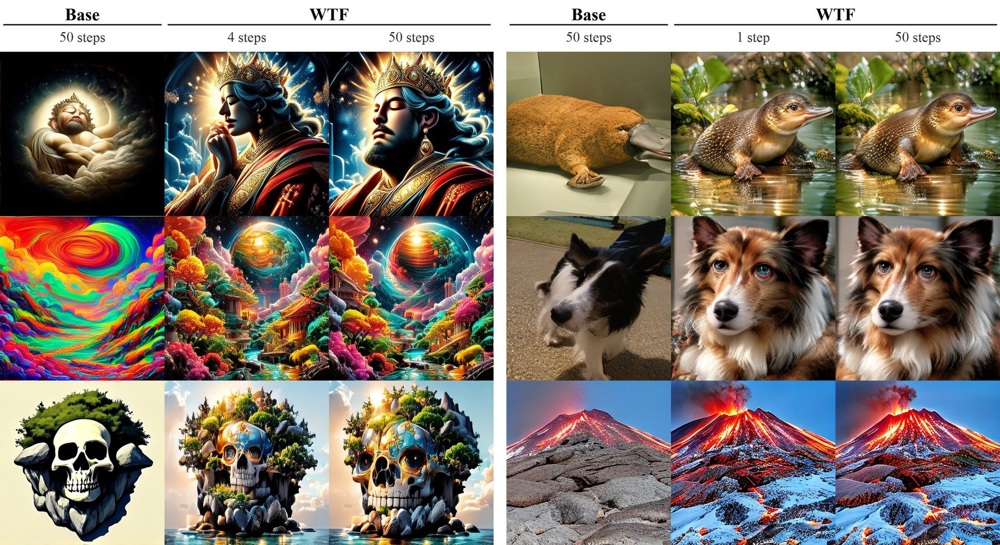
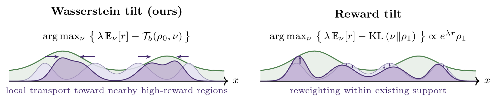
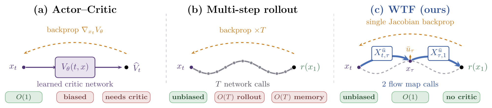
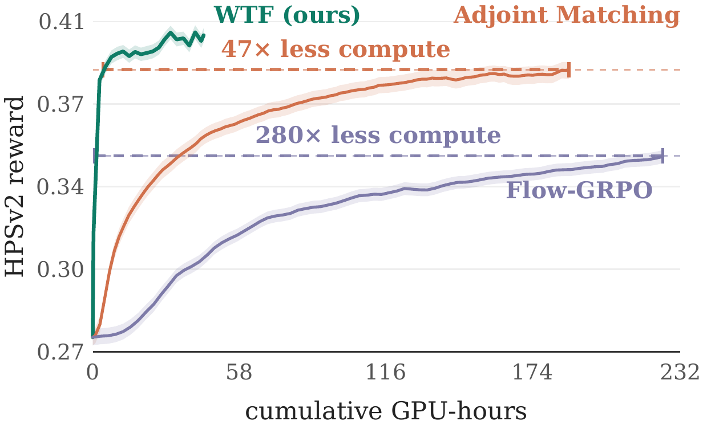
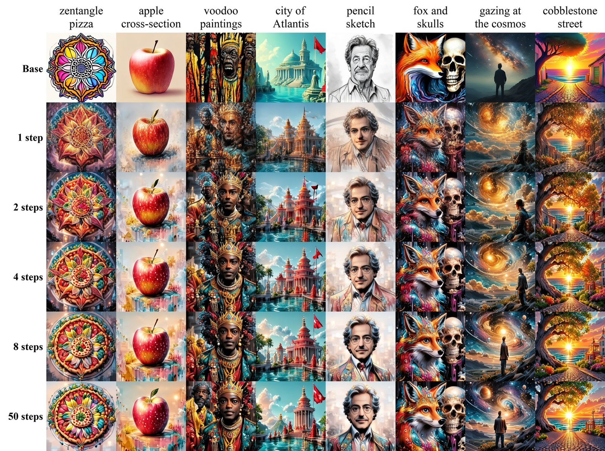
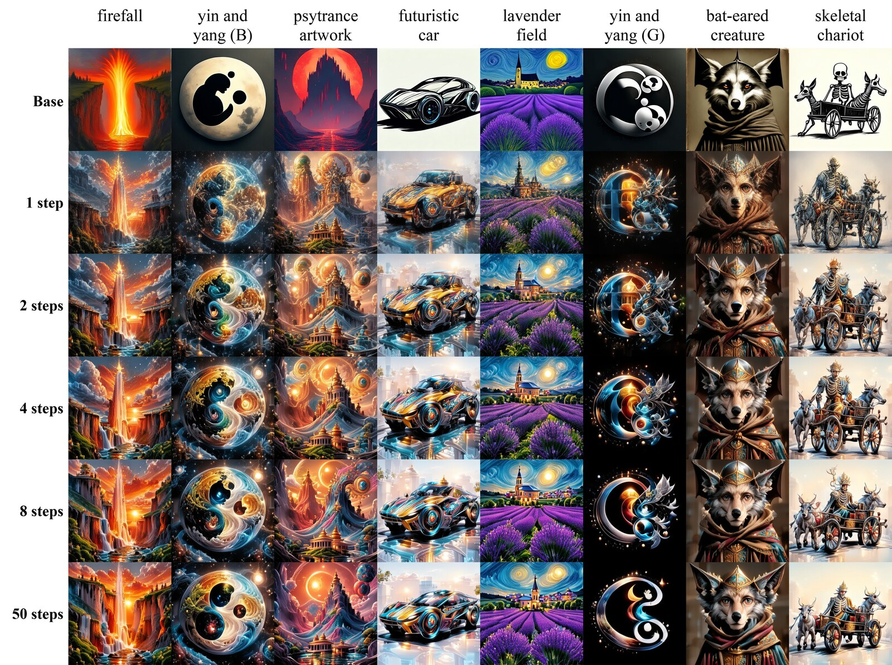

<div align="center">

# WTF?! Simulation-Free Reinforcement Learning <br> with Wasserstein-Tilted Flow Maps

**[Abbas Mammadov](https://abbasmammadov.github.io/)**<sup>1,†,&#42;</sup> &nbsp;&nbsp;
**[Jerry Y. Huang](https://jrrhuang.github.io/)**<sup>2,†,&#42;</sup> &nbsp;&nbsp;
**[Justin Lin](https://www.linkedin.com/in/justin-lin-68a0831a1)**<sup>2,&#42;</sup> <br>
**[Partha Kaushik](https://www.linkedin.com/in/parthakaushik30)**<sup>2</sup> &nbsp;&nbsp;
**[Sheel Shah](https://sheelfshah.github.io/)**<sup>2</sup> &nbsp;&nbsp;
**[Kartik Nair](https://k-rt-k.github.io/)**<sup>2</sup> <br>
**[Yee Whye Teh](https://www.stats.ox.ac.uk/~teh/)**<sup>1</sup> &nbsp;&nbsp;
**[Nicholas M. Boffi](https://nmboffi.github.io/)**<sup>2</sup>

<sup>1</sup>University of Oxford &nbsp;&nbsp; <sup>2</sup>Carnegie Mellon University <br>
<sup>†</sup>Project lead &nbsp;&nbsp; <sup>&#42;</sup>Equal contribution

**NeurIPS 2026 (Spotlight)** 🌟

[](https://arxiv.org/abs/2609.27033)
[](https://wasserstein-tilted-flow-maps.github.io/)
[](https://huggingface.co/wasserstein-tilted-flow-maps/WTF)
[](LICENSE)

Official implementation of "WTF?! Simulation-Free Reinforcement Learning with Wasserstein-Tilted Flow Maps"

</div>

<p align="center">
  
</p>
<p align="center"><em>
Flow maps fine-tuned with WTF for HPSv2. WTF at 4 steps (text-to-image, left) and 1 step (ImageNet-256, right)
matches the quality of its own 50-step generation. The base model is shown at 50 steps.
</em></p>

**Summary.** Reward fine-tuning is usually posed as sampling from a reward-tilted distribution
$\tilde\rho_1 \propto e^{\lambda r}\rho_1$, the solution of a KL-regularized problem. That tilt can only reweight mass the base model already places, and its pathwise form is tractable for diffusions, so
existing methods convert a deterministic flow into a diffusion, fine-tune it, and convert it back.
**Wasserstein-Tilted Flow Maps (WTF)** instead regularize with an optimal transport cost built from the pre-trained drift. The resulting problem is a deterministic optimal control problem on the flow, so a
pre-trained flow map can estimate the value gradient in two network evaluations, with no simulation and no
learned critic. The output is itself a fine-tuned flow map that stays effective from one to many
sampling steps, without post-hoc distillation. On ImageNet-256 and text-to-image, WTF reaches higher reward
than KL-based baselines at comparable or higher diversity, with **up to 280× less training compute**.

---

## Method

<p align="center">
  
</p>

WTF measures deviation from the base model by how much the pre-trained dynamics must be steered. With the
transport cost $c_b$ induced by the pre-trained drift $b$, the regularized problem

```math
\sup_{\nu}\Big\lbrace\lambda\,\mathbb{E}_{\nu}[r]-\mathcal{T}_b(\rho_0,\nu)\Big\rbrace
=\mathbb{E}_{x\sim\rho_0}\Big[\sup_{y}\big\lbrace\lambda\, r(y)-c_b(x,y)\big\rbrace\Big]
```

decouples per sample, so each source sample moves to its own best tradeoff between reward and cost. Its optimal
value equals that of a deterministic optimal control problem, which we solve by policy iteration on the flow
map itself.

<p align="center">
  
</p>

**Simulation-free value estimation.** A frozen reference flow map $\bar w$ jumps from $x_t$ to $x_1$ in two
evaluations, giving an unbiased single-sample Monte Carlo value estimate

```math
\widehat V(t,x)=\lambda\, r(x_1)-\frac{1-t}{2}\,\big\lVert\bar u_\tau(x_\tau)\big\rVert^2,\qquad \tau\sim\mathrm{U}[t,1].
```

The training objective regresses the diagonal of the flow map onto the value gradient and keeps the model a
consistent flow map through self-distillation off the diagonal:

```math
\mathcal{L}_{\mathrm{WTF}}(\hat w)=\mathbb{E}\Big[\big\lVert\hat w_{t,t}(\bar x_t)-b_t(\bar x_t)-\nabla_x\widehat V(t,\bar x_t)\big\rVert^2\Big]+\beta\,\mathcal{L}_{\mathrm{dist}}(\hat w),\qquad \bar w=\mathrm{sg}(\hat w).
```

For the image experiments we use the Euclidean reward gradient $\nabla r(\bar x_1)$ in place of its pullback
through the flow map Jacobian (`estimator.detach: all`). The paper describes the exact variant and the ablation.

---

## Results

**ImageNet-256.** DMF XL/2 fine-tuned on HPSv2. WTF is evaluated at 1 and 250 NFE from the same
fine-tuned flow map. Values are as reported in the paper, with the best fine-tuned value per reward column in bold.

| Method | NFE | HPSv2 ↑ | PickScore ↑ | ImageReward ↑ | DreamSim div. ↑ | CLIP div. ↑ |
|---|:-:|:-:|:-:|:-:|:-:|:-:|
| Base model | 1 | 0.214 | 19.21 | −0.271 | 0.790 | 0.350 |
| Base model | 250 | 0.218 | 19.45 | −0.252 | 0.841 | 0.340 |
| Adjoint Matching | 250 | 0.243 | 20.26 | 0.005 | 0.453 | 0.237 |
| MFM | 250 | 0.291 | 19.83 | 0.544 | 0.379 | 0.189 |
| VFM | 1 | 0.307 | **20.91** | **0.860** | 0.482 | 0.194 |
| **WTF (ours)** | 1 | 0.319 | 20.24 | 0.612 | 0.482 | 0.201 |
| **WTF (ours)** | 250 | **0.330** | 20.45 | 0.718 | 0.460 | 0.177 |

**Text-to-image.** TiM-T2I fine-tuned on HPSv2 with a rank-16 LoRA. Every method is fine-tuned under the
same budget of about 48 GPU-hours on one 8×H100 node, and all checkpoints are evaluated in the same harness.
WTF is a single fine-tuned flow map evaluated at four inference budgets.

| Method | NFE | HPSv2 ↑ | PickScore ↑ | ImageReward ↑ | DreamSim div. ↑ | CLIP div. ↑ |
|---|:-:|:-:|:-:|:-:|:-:|:-:|
| Base model | 1 | 0.228 | 20.36 | 0.182 | 0.548 | 0.413 |
| Base model | 4 | 0.255 | 21.06 | 0.665 | 0.426 | 0.346 |
| Base model | 8 | 0.264 | 21.29 | 0.801 | 0.361 | 0.296 |
| Base model | 50 | 0.274 | 21.58 | 0.997 | 0.281 | 0.239 |
| Adjoint Matching | 50 | 0.357 | 22.75 | 1.380 | 0.210 | 0.188 |
| Flow-GRPO | 50 | 0.303 | 22.06 | 1.210 | 0.250 | 0.215 |
| **WTF (ours)** | 1 | 0.347 | 22.31 | 1.069 | 0.325 | 0.289 |
| **WTF (ours)** | 4 | **0.401** | **22.97** | 1.383 | 0.250 | 0.220 |
| **WTF (ours)** | 8 | 0.400 | 22.93 | 1.394 | 0.233 | 0.212 |
| **WTF (ours)** | 50 | 0.398 | 22.87 | **1.416** | 0.217 | 0.205 |

Diversity is the mean pairwise squared distance between DreamSim or CLIP embeddings of samples that share a
class or prompt.

<p align="center">
  
</p>
<p align="center"><em>
Reward against cumulative training compute (text-to-image, 50 NFE). WTF reaches the peak rewards of
Adjoint Matching and Flow-GRPO with 47× and 280× less compute.
</em></p>

<details>
<summary><b>More samples</b></summary>
<br>
<p align="center">
  
  <br><em>Text-to-image. Each column is one prompt and each row an inference budget, with the base model on top.
  The WTF rows in a column share the same initial noise.</em>
  <br><br>
  
  <br><em>Text-to-image, a second set of prompts in the same layout.</em>
</p>
</details>

---

## Checkpoints

| Checkpoint | Benchmark | Steps | Used for | Download |
|---|---|:-:|---|:-:|
| WTF | Text-to-image (TiM-T2I, LoRA r16) | 1,460 | text-to-image table, all WTF rows | [🤗 link](https://huggingface.co/wasserstein-tilted-flow-maps/WTF/blob/main/wtf_t2i_step1460.pt) |
| WTF, Euclidean gradient | Text-to-image | 800 | exact vs. Euclidean ablation | [🤗 link](https://huggingface.co/wasserstein-tilted-flow-maps/WTF/blob/main/wtf_t2i_euclidean_step800.pt) |
| WTF, exact gradient | Text-to-image | 800 | exact vs. Euclidean ablation | [🤗 link](https://huggingface.co/wasserstein-tilted-flow-maps/WTF/blob/main/wtf_t2i_exact_step800.pt) |
| WTF, seed 0 / 1 / 2 | ImageNet-256 (DMF XL/2) | 12,500 | ImageNet table | [🤗 link](https://huggingface.co/wasserstein-tilted-flow-maps/WTF/tree/main) |

```bash
huggingface-cli download wasserstein-tilted-flow-maps/WTF --include "*.pt" --local-dir checkpoints   # all six, 8.3 GB
```

Text-to-image checkpoints hold rank-16 LoRA weights for TiM-T2I, and the ImageNet checkpoints hold the EMA weights of the full DMF XL/2 network.
The Euclidean-gradient checkpoint at step 800 is an earlier checkpoint of the main WTF run. The Adjoint Matching and Flow-GRPO checkpoints are not released.

---

## Getting started

### 1. Environment

One environment serves both benchmarks: Python 3.11, CUDA 12.1, PyTorch 2.5.1.

```bash
conda create -n wtf python=3.11 -y && conda activate wtf
pip install -r requirements.txt
pip install --no-deps -r requirements-nodeps.txt
# hpsv2 1.2.0 ships without its tokenizer vocabulary; copy it from open_clip
python -c "import os, shutil, hpsv2, open_clip; shutil.copy(os.path.join(os.path.dirname(open_clip.__file__), 'bpe_simple_vocab_16e6.txt.gz'), os.path.join(os.path.dirname(hpsv2.__file__), 'src', 'open_clip'))"
```

`requirements.txt` installs PyTorch first and then a prebuilt `flash-attn` wheel that matches it.
`hpsv2` and `image-reward` over-pin dependencies that conflict with the rest of the stack, so `requirements-nodeps.txt` installs them without their dependencies.

### 2. Pretrained models

**Text-to-image (TiM-T2I).** Clone [TiM](https://github.com/WZDTHU/TiM) and download its text-to-image
checkpoint. TiM encodes prompts with [Gemma-3-1B-it](https://huggingface.co/google/gemma-3-1b-it), a gated model, so accept its license on Hugging Face and log in once.

```bash
git clone https://github.com/WZDTHU/TiM && git -C TiM checkout d01ef74   # the TiM version of the paper
wget -c https://huggingface.co/GoodEnough/TiM-T2I/resolve/main/t2i_model.bin -O TiM/t2i_model.bin
huggingface-cli login

export TIM_REPO=$PWD/TiM PYTHONPATH=$PWD/TiM
export TIM_CKPT=$TIM_REPO/t2i_model.bin
export TIM_CONFIG=$TIM_REPO/configs/t2i/tim_xl_p1_t2i.yaml
```

**ImageNet-256 (DMF XL/2).** Download the [Decoupled MeanFlow](https://github.com/kyungmnlee/dmf) checkpoint.
Training is data-free. Samples are rolled out from noise with random class labels, so no ImageNet images are
needed.

```bash
huggingface-cli download kyungmnlee/DMF dmf_xl_2_256.pt --local-dir checkpoints
export DMF_CKPT=$PWD/checkpoints/dmf_xl_2_256.pt
```

The VAEs, reward models (HPSv2, PickScore, ImageReward) and diversity models (CLIP, DreamSim) download
automatically on first use.

### 3. Evaluate a checkpoint

```bash
# text-to-image: HPSv2, PickScore, ImageReward and diversity at a given NFE
python eval.py t2i/configs/wtf_t2i.yaml --ckpt checkpoints/wtf_t2i_step1460.pt --nfe 4 --gpus 1

# ImageNet-256: the same metrics at NFE 1 or 250 (single GPU)
python eval.py imagenet/configs/wtf_imagenet.yaml --ckpt checkpoints/wtf_imagenet_seed0_step12500.pt --nfe 1
```

Each evaluation writes a JSON file with every metric and the full argument set under `eval_runs/`. The reported text-to-image rows were evaluated on one GPU.
[`docs/EVALUATION.md`](docs/EVALUATION.md) describes both protocols.

### 4. Train

```bash
python run.py t2i/configs/wtf_t2i.yaml               # text-to-image, 8×H100, about 6 hours
python run.py imagenet/configs/wtf_imagenet.yaml     # ImageNet-256, 8×H100, about 3 hours
```

`run.py` reads a YAML config, maps it onto the training CLI of the benchmark, and launches it under
`torchrun` (text-to-image) or `accelerate` (ImageNet). Any config key can be overridden from the command line:

```bash
python run.py t2i/configs/wtf_t2i.yaml --dry-run                          # print the command only
python run.py t2i/configs/wtf_t2i.yaml --set objective.distill_weight=1.0
python run.py imagenet/configs/wtf_imagenet.yaml --set optim.seed=1 --set optim.exp_name=wtf_imagenet_s1
```

Checkpoints and logs go to `exps/<run>/`. Training logs to Weights & Biases. Set `WANDB_MODE=offline` to log locally. [`docs/CONFIGURATION.md`](docs/CONFIGURATION.md) lists every config key and the hyperparameters that
matter most.

### 5. Reproduce the paper

[`REPRODUCE.md`](REPRODUCE.md) is a step-by-step checklist with the exact commands for every reported WTF number,
the expected values, and how to check that a run used the reported recipe.

---

## Repository layout

```
run.py                     training entry point (both benchmarks)
eval.py                    evaluation entry point (both benchmarks)
reference/                 saved training arguments of the reported runs
t2i/                       text-to-image: TiM-T2I substrate, LoRA fine-tuning
  configs/                 reported recipe and ablations
  src/train.py             training loop
  src/lib/ftfm/loss.py     WTF objective
  src/scripts/eval.py      evaluation harness
  scripts/reward_curve.py  reward against training compute
imagenet/                  ImageNet-256: DMF XL/2 substrate, full fine-tuning
  configs/                 reported recipe and ablations
  src/train.py             training loop
  src/loss.py              WTF objective
  src/models/              DMF backbone and JVP-capable attention
  scripts/eval.py          evaluation harness
docs/                      setup, configuration and evaluation details
```

## Acknowledgements

This code builds on [VFM](https://github.com/abbasmammadov/VFM) (base for the loss functions and reward code),
[TiM](https://github.com/WZDTHU/TiM) (text-to-image substrate),
[Decoupled MeanFlow](https://github.com/kyungmnlee/dmf) (ImageNet substrate and the JVP attention kernels),
and VGG-Flow (prompt sets and reward utilities). Rewards and metrics use
[HPSv2](https://github.com/tgxs002/HPSv2), [PickScore](https://github.com/yuvalkirstain/PickScore),
[ImageReward](https://github.com/THUDM/ImageReward) and [DreamSim](https://github.com/ssundaram21/dreamsim).

## Citation

If you find this work useful, please cite our paper:

```bibtex
@article{mammadov2026wtf,
  title={WTF?! Simulation-Free Reinforcement Learning with Wasserstein-Tilted Flow Maps},
  author={Mammadov, Abbas and Huang, Jerry Y and Lin, Justin and Kaushik, Partha and Shah, Sheel and Nair, Kartik and Teh, Yee Whye and Boffi, Nicholas M},
  journal={arXiv preprint arXiv:2609.27033},
  year={2026}
}
```

## License

The code is released under the [MIT License](LICENSE). The pretrained substrates (TiM, DMF, Gemma) and the
reward models carry their own licenses.
